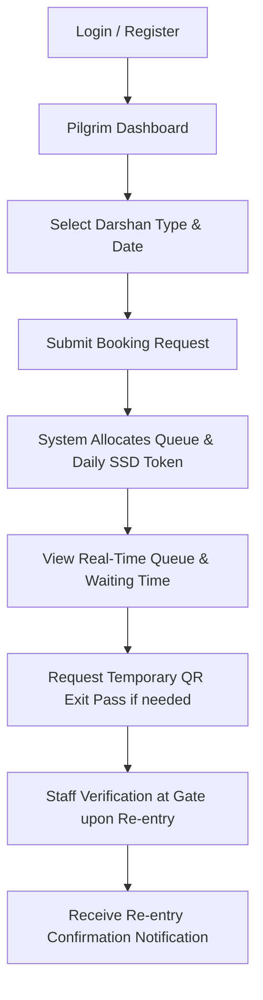
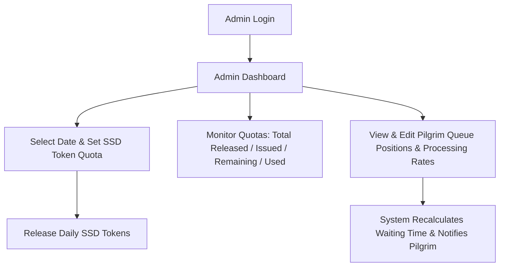
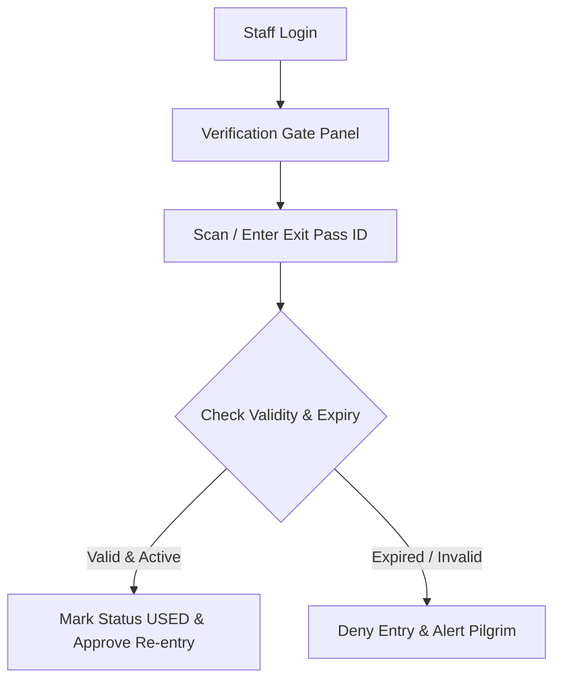
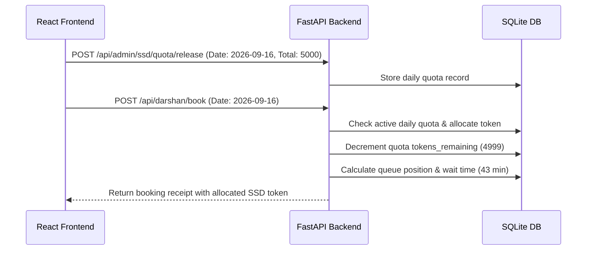

# Project Non-ML Documentation: Smart Pilgrim Queue Management System

## 1. PROJECT OVERVIEW
* **Project Name**: Smart Pilgrim Queue Management System (SPQMS)
* **Purpose**: To provide a prototype queue management framework for Tirumala darshan slots, optimizing pilgrim congestion and queue wait times via rule-based scheduling, daily SSD token quota release, temporary exit pass issuance, and staff gate verification.
* **Problem Solved**: High pilgrim congestion at queue compartments, lack of visibility into real-time waiting times, and rigid queue confinement that prevents pilgrims from stepping out of line for essential needs.
* **Scope**: Handles Pilgrim Registration & Login, Darshan slot scheduling, local persistent SQLite storage of bookings, dynamic deterministic queue positioning updates, daily SSD token quota management, QR-coded temporary gate exit pass generation, gate keeper scanning/re-entry validation, and in-app notifications.
* **SWE Status**: Fully implemented SWE academic prototype.
* **ML Exclusion**: All machine learning operations, datasets (`data/`), model weights (`models/`), and ML training/prediction scripts are strictly excluded from the Software Engineering implementation.

---

## 2. CURRENT IMPLEMENTATION STATUS
* **Pre-existing System**: Machine learning research files and React route links pointing to prediction scripts.
* **SWE Modules Completed**:
  1. User/Admin/Staff Registration & Login.
  2. Darshan Categories catalog.
  3. Persistent Darshan Booking workflow.
  4. Rule-based, deterministic queue positioning and realistic wait time calculations.
  5. Daily SSD Token Quota Release & Tracking module (Admin release form & pilgrim auto-allocation).
  6. QR-coded Exit Pass generation.
  7. Gate Keeper pass verification portal with simulated scan triggers.
  8. Admin control dashboard for updating queue states and releasing daily SSD quotas.
  9. Non-ML Notification alerts.
* **Incomplete Features**: Real camera hardware access (mocked using a simulated scanner canvas frame ready for standard scanner hooks), SMS/Email transmission gateways (mocked using in-app notification registers).

---

## 3. TECHNOLOGY STACK
* **Frontend**: React.js SPA, React Router v7.
* **Backend**: FastAPI (Python 3.13), Uvicorn dev-server.
* **Database**: SQLite3 (Local file `backend/darshan_system.db`).
* **Libraries**: `qrcode.react` (for QR Code SVG generation), `pydantic` (for input validation), `hashlib` (for SHA256 password security).
* **Development Tools**: Node Package Manager (npm), python-venv.

---

## 4. COMPLETE PROJECT DIRECTORY TREE
```text
Tirumala-Smart-Darshan/
├── backend/
│   ├── database.py                 # SQLite database layout, connections, seeding
│   ├── main.py                     # API routing endpoints & server configuration
│   ├── schemas.py                  # Pydantic validation schemas
│   └── darshan_system.db           # Persistent SQLite database file
├── frontend/
│   ├── package.json                # Project configurations & dependency versions
│   ├── public/                     # Static assets
│   └── src/
│       ├── App.js                  # React Router mapping & dynamic navigation
│       ├── App.css                 # Global theme styles
│       ├── index.js                # React render root
│       └── pages/
│           ├── CommonSWE.css       # Forms, dashboard, tables common styles
│           ├── Login.js            # Pilgrim authentication page
│           ├── Register.js         # Pilgrim sign-up page
│           ├── Dashboard.js        # Main pilgrim dashboard console
│           ├── DarshanTypes.js     # Catalog of darshan channels
│           ├── BookingForm.js      # Booking scheduler page
│           ├── BookingConfirmation.js # Receipt screen
│           ├── QueueStatus.js      # Live queue metrics page
│           ├── ExitPass.js         # QR code Exit Pass rendering view
│           ├── NotificationsPage.js # User notifications log
│           ├── AdminPortal.js      # Admin queue & SSD daily quota management console
│           └── StaffPortal.js      # Temple staff gate verification dashboard
├── [ML DIRECTORY — EXCLUDED FROM SWE] (data/, models/, src/, ml codes.zip)
└── venv/                           # Python Virtual Environment
```

---

## 5. FILE-BY-FILE DOCUMENTATION

### Backend Files

#### File: `backend/database.py`
* **Purpose**: Configures local SQLite connections, builds database tables (`users`, `darshan_types`, `bookings`, `queue_status`, `qr_exit_passes`, `ssd_daily_quotas`, `ssd_tokens`, `notifications`), and seeds initial default values.
* **Functions**:
  * `hash_password(password)`: Hashes passwords using hashlib SHA256.
  * `get_db_connection()`: Establishes sqlite3 row-dict connections.
  * `init_db()`: Creates schemas and seeds default admin, staff, user, and darshan channels.

#### File: `backend/main.py`
* **Purpose**: Server entry point configuring API endpoints for non-ML SWE functionalities.
* **APIs**: Auth (`/api/auth/register`, `/api/auth/login`), Darshan Bookings (`/api/darshan/types`, `/api/darshan/book`, `/api/darshan/bookings/{user_id}`), Queue Control (`/api/queue/status/{booking_id}`, `/api/admin/queue/update`, `/api/admin/queue/status`), SSD Quotas (`/api/admin/ssd/quota/release`, `/api/admin/ssd/quotas`), QR Exit Passes (`/api/qr/exit-pass/create`, `/api/qr/exit-pass/{pass_id}`, `/api/qr/exit-pass/verify`), Notifications (`/api/notifications/{user_id}`, `/api/notifications/read`).

#### File: `backend/schemas.py`
* **Purpose**: Pydantic validation models for non-ML payload structures (`UserRegister`, `UserLogin`, `BookingCreate`, `QueueUpdate`, `SsdQuotaRelease`, `ExitPassVerify`).

---

### Frontend Files

#### File: `frontend/src/App.js`
* **Purpose**: Controls client routing mapping and filters navbar options dynamically based on logged-in user roles.

#### File: `frontend/src/pages/Dashboard.js`
* **Purpose**: Pilgrim dashboard displaying active booking, realistic queue metrics (`Queue Position`, `Total Waiting`, `Congestion Status`, `Estimated Waiting Time`), allocated SSD token details, and QR Exit Pass triggers.

#### File: `frontend/src/pages/AdminPortal.js`
* **Purpose**: Administrative console providing Queue Position updates and Daily SSD Token Quota releases (`Date`, `Tokens to Release`).

#### File: `frontend/src/pages/QueueStatus.js`
* **Purpose**: Pilgrim queue tracking console showing explicit deterministic formula breakdowns and live wait time calculations.

#### File: `frontend/src/pages/ExitPass.js`
* **Purpose**: Renders temporary QR Code Exit Passes for queue departure and re-entry within 3 hours.

#### File: `frontend/src/pages/StaffPortal.js`
* **Purpose**: Gate validator dashboard equipping staff to scan/verify pilgrim QR exit passes upon re-entry.

---

## 6. FRONTEND DOCUMENTATION
The frontend is a React SPA using React Router. Session payloads are saved to `localStorage` under `user`. Navbars automatically check the user's role:
* **Unauthenticated**: Login, Register.
* **Pilgrim**: Dashboard, Booking, Notifications, Logout.
* **Staff**: Gate Guard portal, Logout.
* **Admin**: Admin Portal, Logout.

---

## 7. BACKEND DOCUMENTATION
The backend is a FastAPI server running on port `8080`. SQLite is utilized via simple connections. Passwords are secured using SHA256 hashed matches. Dynamic bookings automatically trigger rule-based queue variables and allocate SSD tokens from daily quotas.

---

## 8. DATABASE DOCUMENTATION
* **users**: `id`, `name`, `email`, `password` (SHA256), `role` ('user', 'admin', 'staff').
* **darshan_types**: `id`, `name`, `description`, `availability`.
* **bookings**: `booking_id` (`SPQ-XXXXXX`), `user_id`, `darshan_type`, `date`, `slot`, `status`, `pilgrims_count`, `pilgrim_details`.
* **queue_status**: `queue_id`, `booking_id`, `queue_position`, `queue_count`, `queue_status` ('LOW', 'MODERATE', 'HIGH', 'VERY HIGH'), `waiting_time` (minutes), `people_processed_per_hour`.
* **ssd_daily_quotas**: `quota_id` (`QTA-XXXXXX`), `date`, `total_released`, `tokens_issued`, `tokens_remaining`, `tokens_used`, `status` ('ACTIVE').
* **ssd_tokens**: `token_id` (`SSD-XXXXXX`), `quota_id`, `booking_id`, `user_id`, `token_number`, `status` ('ALLOCATED').
* **qr_exit_passes**: `pass_id` (`PASS-XXXXXX`), `booking_id`, `user_id`, `issue_time`, `expiry_time`, `status` ('Active', 'Used', 'Expired').
* **notifications**: `notification_id`, `user_id`, `message`, `type`, `read`, `timestamp`.

---

## 9. API DOCUMENTATION
| Method | Endpoint | Purpose | Request Body | Response JSON | Auth Required |
|---|---|---|---|---|---|
| POST | `/api/auth/register` | Sign up user | `UserRegister` | User info dict | No |
| POST | `/api/auth/login` | Log in user | `UserLogin` | User session dict | No |
| GET | `/api/darshan/types` | List darshan channels | None | List of channels | Yes (Pilgrim) |
| POST | `/api/darshan/book` | Schedule slot | `BookingCreate` | Booking ticket receipt | Yes (Pilgrim) |
| GET | `/api/darshan/bookings/{user_id}` | Fetch bookings | None | Booking list | Yes (Pilgrim) |
| GET | `/api/queue/status/{booking_id}` | Track queue | None | Queue position & wait time | Yes (Pilgrim) |
| POST | `/api/admin/queue/update` | Modify queue index | `QueueUpdate` | Success code & wait time | Yes (Admin) |
| GET | `/api/admin/queue/status` | List queues | None | Queue logs list | Yes (Admin) |
| POST | `/api/admin/ssd/quota/release` | Release daily SSD quota | `SsdQuotaRelease` | Quota release status | Yes (Admin) |
| GET | `/api/admin/ssd/quotas` | List daily SSD quotas | None | List of daily quotas | Yes (Admin) |
| POST | `/api/qr/exit-pass/create` | Issue exit pass | `{booking_id, user_id}`| Pass record | Yes (Pilgrim) |
| GET | `/api/qr/exit-pass/{pass_id}` | Fetch pass data | None | Exit Pass details | Yes (Pilgrim/Staff)|
| POST | `/api/qr/exit-pass/verify` | Gate verification | `ExitPassVerify` | Validity check | Yes (Staff) |
| GET | `/api/notifications/{user_id}`| Fetch alerts | None | Notifications list | Yes (Pilgrim) |
| POST | `/api/notifications/read` | Clear notifications | `{user_id}` | Success status | Yes (Pilgrim) |

---

## 10. USER FLOW


---

## 11. ADMIN FLOW


---

## 12. TEMPLE STAFF FLOW


---

## 13. DATA FLOW


---

## 14. AUTHENTICATION AND AUTHORIZATION
Authenticated user state resides in `localStorage`. Passwords are encrypted as SHA256 string signatures on database insert. The React router matches roles (`user`, `admin`, `staff`) against routes on mount, redirecting invalid users.

---

## 15. QR EXIT PASS LOGIC
Temporary exit passes are issued on booking references. The QR Code encodes pass details. Valid for 3 hours from creation. Once scanned and verified by staff, the state toggles from `Active` to `Used`, invalidating the code for further attempts.

---

## 16. QUEUE MANAGEMENT LOGIC
Pilgrim queue tracking is rule-based and deterministic (no Machine Learning models are used).

### Deterministic Formula:
$$\text{waiting\_time\_hours} = \frac{\text{people\_ahead}}{\text{people\_processed\_per\_hour}}$$
$$\text{waiting\_time\_minutes} = \text{waiting\_time\_hours} \times 60 = \left(\frac{\text{people\_ahead}}{\text{people\_processed\_per\_hour}}\right) \times 60$$

Where:
- `people_ahead`: The number of pilgrims ahead of the user in the queue line (`queue_position`).
- `people_processed_per_hour`: The processing rate of the compartment gate (default: 60 pilgrims/hour).
- `waiting_time_minutes`: The calculated wait time stored as integer minutes.

### Unit Formatting Rules:
- If `waiting_time_minutes < 60`: Rendered as `"43 minutes"`.
- If `waiting_time_minutes >= 60`: Rendered as `"2 hours 15 minutes"` (or `"1 hour"` when minutes remainder is 0).

### Queue Congestion Levels:
Determined deterministically from compartment occupancy:
- `LOW`: `queue_count <= 150`
- `MODERATE`: `queue_count <= 400`
- `HIGH`: `queue_count <= 700`
- `VERY HIGH`: `queue_count > 700`

---

## 17. SSD TOKEN LOGIC
Slotted Sarva Darshan (SSD) tokens are managed at the daily quota level:
1. **Daily Quota Release**: Temple Administrators select a date and enter the quota quantity (e.g. 5000 tokens for `2026-09-16`).
2. **Quota Tracking**: The system maintains `total_released`, `tokens_issued`, `tokens_remaining`, `tokens_used`, and `status`.
3. **Auto Allocation**: When pilgrims book general/special darshan for that date, the backend automatically issues the next token, increments `tokens_issued`, and decrements `tokens_remaining`.
4. **Pilgrim View**: Allocated SSD token details (`Token Number`, `Status`, `Date`) are rendered directly on the Pilgrim Dashboard without requiring manual token ID entry.

---

## 18. NOTIFICATION LOGIC
Action triggers (booking creation, SSD token allocation, queue update by admin, exit pass generation, gate staff verification) automatically append rows to the `notifications` table. The user dashboard fetches and lists these events in real time.

---

## 19. SETUP INSTRUCTIONS

### Backend Server setup:
1. Initialize SQLite Database:
   ```powershell
   python -c "from backend.database import init_db; init_db()"
   ```
2. Activate Virtual Environment and start server:
   ```powershell
   .\venv\Scripts\activate
   uvicorn backend.main:app --reload --port 8080
   ```

### Frontend Server setup:
1. Navigate to the frontend directory:
   ```powershell
   cd frontend
   ```
2. Start Dev server:
   ```powershell
   npm start
   ```

---

## 20. ENVIRONMENT VARIABLES
* `PORT`: Default backend port is `8080`.
* `DB_PATH`: SQLite database file path is resolved dynamically relative to `backend/main.py`.

---

## 21. TESTING STATUS
| Feature | Tested? | Result | Notes |
|---|---|---|---|
| Registration | Yes | Passed | Custom roles creation verified |
| Login | Yes | Passed | SHA256 hashed checks verified |
| Dashboard | Yes | Passed | Real-time loading & realistic units verified |
| Booking | Yes | Passed | SQLite persistency verified |
| Queue Status | Yes | Passed | Deterministic formula calculation verified |
| SSD Daily Quota Release | Yes | Passed | Quota tracking & duplicate prevention verified |
| SSD Token Allocation | Yes | Passed | Automatic allocation to bookings verified |
| QR Exit Pass | Yes | Passed | Validates 3 hour limits |
| Staff Verification | Yes | Passed | Pass toggle to USED verified |
| Admin Console | Yes | Passed | Interactive queue updates & quota forms verified |
| Notifications | Yes | Passed | In-app alerts verified |

---

## 22. KNOWN LIMITATIONS
Camera scan features require physical scanner modules or hardware routing, which is simulated in this prototype.

---

## 23. FUTURE WORK
* Secure JWT Token header inclusion.
* SMS Gateway Integration.

---

## 24. ML EXCLUSION NOTE
"The Machine Learning components present in the workspace belong to a separate academic component and are intentionally excluded from the Software Engineering implementation and this documentation."
